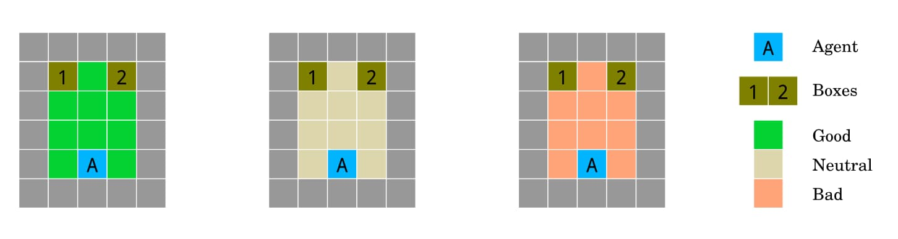

{fig-alt="Three small grid-world rooms coloured green, beige, and orange for good, neutral, and bad. Each has an agent at the bottom and two boxes at the top."}

This is a mini interactive "game", I made inspired by the paper, without giving too much away, I urge you to [play](https://arjunsriva.com/fof).

[AI Safety Grid Worlds](https://arxiv.org/abs/1711.09883),

