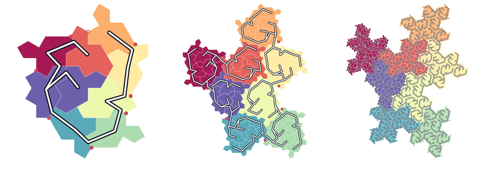

In 1891 David Hilbert drew a single line that passes through every cell of a square grid. In 2023 four mathematicians found the spectre, a single shape that covers the plane but only in patterns that never repeat. This piece puts the two together: one unbroken line that passes through every tile of a spectre tiling, visiting each tile once, generated by a small recursive recipe and proven to work at every scale.

::: {.column-margin .spectre-status}
**How sure is this?** The main claim is computer-assisted. Two checkers that share no code accept the certificate, but both were written in the same session and nobody else has reviewed them. A short literature search found general theory and no construction for the spectre, so whether this is new is a question for an expert. Each claim's status is in [Where it stands](#where-it-stands).
:::

```{=html}
<figure class="spectre-fig" data-spectre="thread" aria-labelledby="thread-caption">
  <p class="st-cap st-live" data-role="cap" aria-live="polite"></p>
  <div class="st-plate st-live"><canvas data-role="canvas" role="img" aria-label="A patch of spectre tiles with one continuous thread that visits each tile once"></canvas></div>
  
  <div class="st-bar st-live">
    <button data-role="build" type="button">Build it up</button>
    <button data-role="play" type="button">Draw it</button>
    <input data-role="pos" type="range" min="0" max="1" step="1" value="1" aria-label="Position in the animation">
    <span data-role="read"></span>
    <div class="st-seg" role="group" aria-label="Patch size">
      <button type="button" data-level="3" aria-pressed="false">559 tiles</button>
      <button type="button" data-level="4" aria-pressed="false">4,401 tiles</button>
    </div>
    <div class="st-chips" role="group" aria-label="Colours">
      <button type="button" data-pal="dusk" aria-pressed="true" aria-label="Dusk colours"></button>
      <button type="button" data-pal="kelp" aria-pressed="false" aria-label="Kelp colours"></button>
      <button type="button" data-pal="ember" aria-pressed="false" aria-label="Ember colours"></button>
    </div>
    <label class="st-tog"><input data-role="thread" type="checkbox" checked> Thread</label>
  </div>
  <figcaption id="thread-caption">Every piece is the same 14-sided tile. Colour runs from the start of the thread to its end. <em>Build it up</em> replays the construction from one tile; <em>Draw it</em> traces the line in order.</figcaption>
</figure>
```

## The two ingredients

**The spectre** is a single shape, found in 2023 by David Smith, Joseph Samuel Myers, Craig Kaplan and Chaim Goodman-Strauss, that covers the infinite plane with no gaps but only in patterns that never repeat.[^spectre] Mathematicians looked for such a shape for about sixty years.

[^spectre]: Smith, Myers, Kaplan and Goodman-Strauss, ["A chiral aperiodic monotile"](https://arxiv.org/abs/2305.17743) (2023). Everything here rests on their substitution and on their theorem that every spectre tiling carries the hierarchy described below.

**A space-filling curve**, like Hilbert's, threads through every cell of a square grid while keeping cells that are close on the line close in the plane. Databases and image formats use this to flatten two-dimensional data into one dimension without scattering neighbours.

## The question

The spectre answers: is there one shape that tiles the plane, but only without repeating? This line answers the next question:

> Can you walk through the whole tiling one tile at a time, always stepping to a tile that touches the one you are on, visiting every tile exactly once, and never returning to a region after you have left it?

Yes, and a fixed recipe of thirty routes produces the walk at any size.

Said another way: Hilbert threaded a square grid with one line. Does that depend on the grid being regular? Here it still works on a pattern with no repetition at all.

"Never returning to a region" is the part that matters. Without it you are asking for some path through every tile. With it you are asking for a path that respects the nested structure of the tiling at every scale, which is the property that makes Hilbert's curve useful: tiles near each other along the line are near each other in the plane, at every scale.

## How it is built

It is the same move as the Hilbert animation people have seen: draw a small route, make copies, join them, repeat. Press *Build it up* in the figure above to watch it.

- **The tiling groups itself.** Spectre tiles cluster in groups of 8 (occasionally 7, where one piece is a pair of tiles). Those groups cluster into bigger groups of 8, and so on forever. Each bigger group is a rougher, larger cousin of the smaller one, not an exact copy.
- **The motif is a route through one group.** "Enter here, visit the 8 pieces in this order, leave there." To grow the curve, replace each piece with its own route. The ends line up, so they join into one line.
- **One tile, then 9, 71, 559, 4,401.** The route used in the figure starts with a copy of itself, so the curve on 4,401 tiles begins with the curve on 559, which begins with the curve on 71, then 9, then 1. The build-up is one line revealed in nested prefixes.

### Why thirty routes

Hilbert needs one route, turned four ways. The spectre's groups have no symmetry, and the ends of a route have to meet the next group's start in awkward places, so it takes thirty. Each route says which of the thirty to use inside each of its 8 pieces.

A route is written as a shape and two addresses: where the line enters and where it leaves. An address is a word of child numbers read from the top down, and it repeats, so the same word names a tile at every size. `0(5)` means child 0, then child 5 forever. The route in the figure is `D|(5)|0(5)`: it enters at the tile reached by always taking child 5, and leaves at the tile reached by taking child 0 once and then child 5 forever. Its production visits the children in the order 5, 6, 7, 4, 3, 2, 1, 0, and the first two of those use the same route again.

Thirty is the fewest possible among addresses of that simple form (one letter, then one repeating letter); an exact optimiser proves it. With longer addresses the floor might be lower: in the next family up, the best known bound is 28 to 30.

## Why it works at every size

The recipe produces a line at every size you try. The question is whether it ever fails at some size nobody tried. The proof reduces infinitely many sizes to a few dozen checks.

1. **Start small.** At the level of 71 tiles, an exhaustive search finds a valid route for each of the thirty states.
2. **What growing needs.** A big route is its children's routes laid end to end. That works if, every time one child's route ends, the tile it ends on shares an edge with the tile where the next child's route begins. Call that a junction. The recipe has 200 of them, and each must hold at every size.
3. **Junctions point to smaller junctions.** Because addresses are words read from the top down, dropping the first letter of each address turns a junction between two groups into the same claim about two of their children, one level down. So each junction points to another junction.
4. **Positions are exact and finite.** Every corner of every tile can be written with four integers, and the key points of a group at one level are a fixed integer formula of those at the level below. Two relative positions that agree at 16 consecutive levels agree forever, so each one has a fingerprint, and only 24 occur.
5. **The chain closes.** Following the 200 junctions downward reaches 32 distinct cases and then cycles. Each of the 32 is checked directly at the 71-tile level in exact arithmetic. If every case holds at one level, it holds at the next one up, and so by induction it holds at every level.

That argument needs no floating point. It rests on one fact from linear algebra: a linear function that vanishes on 16 consecutive iterates of a 16-dimensional linear recurrence vanishes on all later ones. Here the iterates span only 6 dimensions.

The certificate is small enough to check yourself. The second checker uses only Python's standard library and shares no code with the first; on a laptop it finishes in under ten seconds:

```text
python3 independent_check.py results/rule_min30.json
...: 30 states; base paths found by plain search; 200 junctions certified
     through 32 closed triples over 24 relative positions
INDEPENDENT CHECK OK
```

### From a patch to the whole plane

A group's route fixes the route of the group below it, so a line through one patch extends outward through ever-larger patches. The route in the figure helps here too: besides starting with a copy of itself, it contains a second copy at step 2 of 8, with tiles piling up on both sides. That copy, two levels down, sits strictly inside: 2, 4 and 10 tiles from the edge at successive sizes. Each step outward therefore adds at least a full ring of tiles, and the nested patches exhaust the plane. The result is one line, running off to infinity in both directions, through every tile of that tiling. This "strictly inside" claim is certified at every level by a second closure argument of the same kind, which reaches 17 cases.

Some spectre tilings split into several regions that no finite patch crosses. There the argument gives one line per region, and joining them is not addressed.

## Not just non-repeating: it can't repeat

A space-filling curve that never repeats is old news. Hilbert's own curve never repeats: the grid under it does, the line does not. But that is a choice. The same grid can be threaded by a plain back-and-forth snake that repeats.

Two words keep these apart:

- **Non-periodic:** it happens not to repeat.
- **Aperiodic:** it cannot repeat, because the pieces rule it out.

Every piece of this thread sits in the same cell shape, and that shape cannot be arranged periodically. No thread through these cells could repeat, however it was routed. The spectre turns "doesn't repeat" into "can't repeat".

A ladder of versions of the question:

1. A curve that happens not to repeat. Known since Hilbert.
2. A curve on a tiling forced not to repeat, with two tile shapes. Done in 2014 on the Ammann A5 tiles.[^hassell]
3. A curve on a tiling forced not to repeat, with one tile shape, with a proof. This piece. Novelty unconfirmed.
4. One tile with a mark on it, such that fitting copies together forces one unbroken line. Ruled out on the spectre in its direct forms; see [below](#can-the-tile-draw-it-by-itself).

[^hassell]: Hassell, ["A Plane-Filling Curve Using Ammann A5 Tiles"](https://archive.bridgesmathart.org/2014/bridges2014-389.pdf), Bridges 2014.

### Order without symmetry

- A **spiral** covers a page with one uncrossed line too, but it is completely regular: one formula, and far from the centre it looks like evenly spaced parallel lines.
- A **random scribble** has no symmetry and no rule.
- **This thread** has no translation symmetry and no mirror symmetry, yet it is fully determined by thirty route patterns. Any stretch of it shows up again and again elsewhere, never far away, and the copies never fall into a grid.

Order without symmetry is what made aperiodic tilings and quasicrystals surprising. This is a line that carries that property through a two-dimensional pattern, while staying local the way Hilbert's curve does.

### Is it a fractal?

In structure, yes. It is built by one rule applied at every scale. At any finite size it is an ordinary line; in the limit it comes arbitrarily close to every point of the region. The outlines of the clusters are ragged at every scale: boundary tiles grow about 4.25 times per round while width grows about 2.8 times, which gives an outline dimension of roughly 1.4. That is an estimate from counts, not a proof.

It is never an exact copy of itself. Each larger cluster is a rougher cousin of the smaller one. The technical name for this kind of object is a graph-directed fractal: several shapes, each built from smaller versions of one another.

## How good is the line?

Locality measures how far apart two tiles can be in the plane compared with how far apart they are along the line: the largest squared distance, divided by tile area times the number of steps between them. Lower is better. Hilbert's curve scores 6.

| Tiles | Worst stretch |
|---|---|
| 4,401 | 8.07 |
| 34,649 | 8.48 |
| 272,791 | 8.69 |
| 2,147,679 | 8.87 |
| 16,908,641 | 8.94 |
| every size | 8.97984 |

: Worst-case locality of the thirty-route line, the exact maximum over all pairs at each size

From 272,791 tiles up, the worst pair is always the same self-similar pair of tiles, and following it to forty levels in exact arithmetic gives 8.97984. A second search shows that no pair at any size does worse than 8.979841, so the constant is pinned between 8.979840 and 8.979841.[^bound] Searching over recipes found better ones, 8.766 with 122 routes and 8.745 with 181, both accepted by both checkers. How low it can go is open.

[^bound]: The upper bound runs in double-precision floating point, treats the geometry as settled beyond level 45 (it changes by less than 4×10⁻¹⁵ there) and has one implementation. Strong evidence with tight controls, short of a formal proof.

## Can the tile draw it by itself?

The dream version of this object is a single marked tile: draw a stroke on the spectre, lay copies edge to edge, and the strokes join into one line on their own. On the spectre the direct forms fail.

- **One stroke per tile** (in by one edge, out by another) cannot be consistent: each edge of a spectre meets three to five different edges of its neighbours.
- **Seven arcs per tile**, pairing up all 14 edges without crossings: there are 429 ways, and every one produces closed loops on a 559-tile patch that occurs in every spectre tiling, so none gives a single line.

What does work is a small palette. Record, for each tile, the edge where the line enters and the edge where it leaves. Drawn the natural way, through each tile's centre and across the middle of each shared border, the thread uses the strokes below. Pick one to see where it is used.

```{=html}
<figure class="spectre-fig" data-spectre="marks" aria-labelledby="marks-caption">
  <p class="st-cap st-live" data-role="cap" aria-live="polite"></p>
  <div class="st-plate st-live"><canvas data-role="canvas" role="img" aria-label="The 4,401-tile patch, with the tiles that carry the selected stroke left in colour"></canvas></div>
  <div class="st-grid st-live" data-role="grid" role="group" aria-label="Marked tiles"></div>
  <figcaption id="marks-caption">The <span data-role="npal">32</span> marked tiles of the thread on 4,401 tiles. Each is the same shape carrying one stroke, from one edge, through the centre, to another. The number under each is its share of all the tiles.</figcaption>
</figure>
```

That is 32 strokes. Choosing the crossing edges to make the kit as small as possible, rather than to draw the line nicely, brings it to 20, and an exact solver proves 20 is the minimum for this line on 4,401 tiles; the same 20 suffice on 34,649. Another line might need fewer. Whether the marked tiles *force* the line, so that no other arrangement of them is possible, is untested.

## A simpler form that didn't make it

The thirty routes exist because a path has two ends that must land in the right places. A tree has no ends, and the tiling supplies one. The 8 pieces of every cluster sit in a ring, and each piece touches the next at one shared corner, where one tile from each piece meets the other along an edge. Open every one of those doors but one, at every size, and you grow a tree through all the tiles. Walk around the tree with a hand on it and you trace one closed loop that never crosses itself.

```{=html}
<figure class="spectre-wide">
  
  <figcaption>The spectre tree. Left: 8 pieces in a ring, joined at the corners they share (red dots; the hollow one is left open). Middle: each piece replaced by a cluster, joined at the same corners. Right: 559 tiles; the dark outline around the tree is one closed loop.</figcaption>
</figure>
```

The whole recipe is one sentence. The price is that the loop passes some tiles two or three times, covers a cluster in up to three separate visits, and is about half as tidy by the locality measure (20.1 against 8.07 on 4,401 tiles). It gives up exactly what makes Hilbert's curve Hilbert's, so the thread stays the object, and the tree stays a side result.

That trade looks like a real feature of the spectre, not of this search. Hilbert can reuse one motif because the square has symmetry; a shape with no symmetry needs each variant written out. On the spectre, the simplest recipe and the Hilbert properties pull against each other.

## So what?

Nothing in daily life changes. The fair answers:

1. It answers a natural question about a famous new shape.
2. You can make things with it: a plotter, embroidery machine, laser cutter or 3D printer can draw an endless non-repeating design in one stroke.
3. It may help people who simulate quasicrystals, who often thread a two-dimensional material into a one-dimensional chain. Untried.
4. The proof method, reducing infinitely many sizes to a few dozen checkable cases, should carry to other tilings.
5. It went from a vague idea to a machine-checked result in a few days of conversation with an AI.

## Where it stands {#where-it-stands}

| Claim | How it is known |
|---|---|
| The thirty routes give a valid line at every size | Exact computation; two checkers that share no code |
| One line through every tile of a whole tiling | Exact computation; one implementation |
| Thirty is the fewest, for the simplest kind of address | Exact optimiser; one implementation |
| Locality between 8.979840 and 8.979841 | Floating point, one stated assumption; one implementation |
| 20 marked tiles are the minimum for this line | Exact solver on 4,401 tiles; one implementation |
| No single marked tile draws it | Exhaustive on the direct forms; one implementation |
| It is new | Unknown |

: Status of each claim, November 2026

Both checkers were written by the same author in one session, and both read the substitution from the same published algorithm and rely on the same 16-level fact. An error in either would pass both. The general method is known: Rao and Zhang's work on space-filling curves of self-similar sets describes exactly this kind of ordered structure, but the spectre's substitution is not self-similar in their sense, so their theorem does not apply as stated.[^rao] Ozkaraca's thesis builds such orders for other tiling substitutions.[^ozk] About ten searches turned up no curve through the tiles of the spectre or the hat. That is weak evidence of absence, and the next step is to ask someone who knows this literature.

[^rao]: Rao and Zhang, ["Space-filling curves of self-similar sets (I): iterated function systems with order structures"](https://arxiv.org/abs/1509.06276).

[^ozk]: Ozkaraca, [PhD thesis](https://theses.gla.ac.uk/81993/), University of Glasgow, 2021.

What is open:

- **Better locality.** How low can the constant go, and can a small recipe beat 8.98? The only lower bound is 2.84, from the diameter of a cluster.
- **A smaller recipe.** Thirty is minimal for the simplest addresses; longer addresses are unexplored.
- **Fewer strokes.** This line needs 20. Another might need fewer; a guess, labelled as one, is the low teens.
- **The hat**, the spectre's sibling with tiles in two orientations, by the same method.
- **Vertex cycles.** A line through every *corner* of the spectre tiling, the analogue of a known result for Ammann–Beenker tilings.[^flicker]

[^flicker]: Singh, Lloyd and Flicker, ["Hamiltonian cycles on Ammann-Beenker tilings"](https://arxiv.org/abs/2302.01940), Physical Review X, 2024.

## How this was figured out

This came from three days of conversation with Claude, 10 to 12 November 2026. Claude wrote the tiling code, the searches, both checkers and the drawings, and ran them; I set the questions, pushed on what the object should be and made the calls. Everything is kept as numbered scripts with logs from a from-scratch rerun, so each figure in this piece can be regenerated.

The methods were plain ones:

- **Exhaustive search** for every possible route through clusters of up to 34,649 tiles, which showed that from 71 tiles up the same handful of visiting orders keep working, and suggested that a finite recipe exists.
- **Exact arithmetic**, with every corner written as four integers, for every geometric fact the proof uses.
- **An exact optimiser** to find the smallest recipe and the smallest set of strokes.
- **Branch and bound** to find the worst pair of tiles among 16.9 million without comparing every pair.

### Being wrong carefully

The wrong turns stay on the record:

- **The tile was typed from memory, wrong.** Three of its corners had the wrong height. The tile counts came out right (9, 71, 559), but no two tiles shared an edge. Plotting one cluster against a reference implementation found it.
- **A fake violation of 56.** The first locality bound carried positions in floating point down the hierarchy. The error grows 2.8 times per level, and at depth 34 it reported a stretch of 56, which is nonsense. Carrying exact integers and refreshing the floats from them fixed it.
- **"29 strokes" was wrong, and was reported anyway.** Neighbouring spectres usually share two or more edges, and the first count chose the crossing edge separately for each tile, so the two tiles at a join could disagree about where the line crossed. A second attempt had the same flaw. The correct count, with both tiles agreeing at every join, is 20.
- **"The arcs cut across neighbouring tiles."** Claude told me this about an earlier way of drawing the line. Measured, they did not.
- **Low-level rankings mislead.** Recipes that scored best on 4,401 and 34,649 tiles turned out worse in the limit. Only the bound valid at every size could rank them.

The rule that came out of these: keep what is proven exactly, what is computed in floating point, and what is only observed at the sizes tried in separate columns, and say which is which.

::: {.archive-note}
The spectre and its substitution are by David Smith, Joseph Samuel Myers, Craig Kaplan and Chaim Goodman-Strauss; the code here follows Kaplan's construction as ported in [shrx/spectre](https://github.com/shrx/spectre). Related work: Rao and Zhang on space-filling curves of self-similar sets, Ozkaraca on order structures for tiling substitutions, Hassell's Ammann A5 curve, and Singh, Lloyd and Flicker on Hamiltonian cycles on Ammann–Beenker tilings and dimers on the spectre. The research package, with the checkers, the logs and a plain-language explainer, is in this site's repository under [`scripts/spectre/`](https://github.com/arjunbazinga/arjunbazinga.github.io/tree/master/scripts/spectre).
:::

```{=html}
<script src="/static/spectre/thread.js" defer></script>
```
