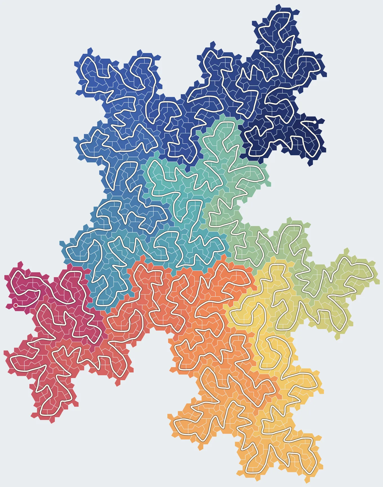

Draw a grid of squares, and try to draw one line through every square. Visit each square once, never lift your pen, and never leave a block of squares until you've filled it. In 1891 David Hilbert found the trick. Solve it for four squares. Then treat each block of four as a single square and solve it again. Repeat, and the line fills the plane.

```{=html}
<figure class="hilbert-fig">
  <svg viewBox="-4 -4 688 208" role="img" aria-label="Hilbert's curve on grids of 4, 16 and 64 squares: each version is four copies of the one before, joined end to end."><g class="h-grid" fill="none" stroke="currentColor" stroke-opacity="0.18" stroke-width="1"><rect x="0.00" y="0.00" width="100.00" height="100.00"/><rect x="0.00" y="100.00" width="100.00" height="100.00"/><rect x="100.00" y="0.00" width="100.00" height="100.00"/><rect x="100.00" y="100.00" width="100.00" height="100.00"/></g><polyline class="h-line" fill="none" stroke="currentColor" stroke-width="3" stroke-linejoin="round" stroke-linecap="round" points="50.00,150.00 50.00,50.00 150.00,50.00 150.00,150.00"/><g class="h-grid" fill="none" stroke="currentColor" stroke-opacity="0.18" stroke-width="1"><rect x="240.00" y="0.00" width="50.00" height="50.00"/><rect x="240.00" y="50.00" width="50.00" height="50.00"/><rect x="240.00" y="100.00" width="50.00" height="50.00"/><rect x="240.00" y="150.00" width="50.00" height="50.00"/><rect x="290.00" y="0.00" width="50.00" height="50.00"/><rect x="290.00" y="50.00" width="50.00" height="50.00"/><rect x="290.00" y="100.00" width="50.00" height="50.00"/><rect x="290.00" y="150.00" width="50.00" height="50.00"/><rect x="340.00" y="0.00" width="50.00" height="50.00"/><rect x="340.00" y="50.00" width="50.00" height="50.00"/><rect x="340.00" y="100.00" width="50.00" height="50.00"/><rect x="340.00" y="150.00" width="50.00" height="50.00"/><rect x="390.00" y="0.00" width="50.00" height="50.00"/><rect x="390.00" y="50.00" width="50.00" height="50.00"/><rect x="390.00" y="100.00" width="50.00" height="50.00"/><rect x="390.00" y="150.00" width="50.00" height="50.00"/></g><polyline class="h-line" fill="none" stroke="currentColor" stroke-width="3" stroke-linejoin="round" stroke-linecap="round" points="265.00,175.00 315.00,175.00 315.00,125.00 265.00,125.00 265.00,75.00 265.00,25.00 315.00,25.00 315.00,75.00 365.00,75.00 365.00,25.00 415.00,25.00 415.00,75.00 415.00,125.00 365.00,125.00 365.00,175.00 415.00,175.00"/><g class="h-grid" fill="none" stroke="currentColor" stroke-opacity="0.18" stroke-width="1"><rect x="480.00" y="0.00" width="25.00" height="25.00"/><rect x="480.00" y="25.00" width="25.00" height="25.00"/><rect x="480.00" y="50.00" width="25.00" height="25.00"/><rect x="480.00" y="75.00" width="25.00" height="25.00"/><rect x="480.00" y="100.00" width="25.00" height="25.00"/><rect x="480.00" y="125.00" width="25.00" height="25.00"/><rect x="480.00" y="150.00" width="25.00" height="25.00"/><rect x="480.00" y="175.00" width="25.00" height="25.00"/><rect x="505.00" y="0.00" width="25.00" height="25.00"/><rect x="505.00" y="25.00" width="25.00" height="25.00"/><rect x="505.00" y="50.00" width="25.00" height="25.00"/><rect x="505.00" y="75.00" width="25.00" height="25.00"/><rect x="505.00" y="100.00" width="25.00" height="25.00"/><rect x="505.00" y="125.00" width="25.00" height="25.00"/><rect x="505.00" y="150.00" width="25.00" height="25.00"/><rect x="505.00" y="175.00" width="25.00" height="25.00"/><rect x="530.00" y="0.00" width="25.00" height="25.00"/><rect x="530.00" y="25.00" width="25.00" height="25.00"/><rect x="530.00" y="50.00" width="25.00" height="25.00"/><rect x="530.00" y="75.00" width="25.00" height="25.00"/><rect x="530.00" y="100.00" width="25.00" height="25.00"/><rect x="530.00" y="125.00" width="25.00" height="25.00"/><rect x="530.00" y="150.00" width="25.00" height="25.00"/><rect x="530.00" y="175.00" width="25.00" height="25.00"/><rect x="555.00" y="0.00" width="25.00" height="25.00"/><rect x="555.00" y="25.00" width="25.00" height="25.00"/><rect x="555.00" y="50.00" width="25.00" height="25.00"/><rect x="555.00" y="75.00" width="25.00" height="25.00"/><rect x="555.00" y="100.00" width="25.00" height="25.00"/><rect x="555.00" y="125.00" width="25.00" height="25.00"/><rect x="555.00" y="150.00" width="25.00" height="25.00"/><rect x="555.00" y="175.00" width="25.00" height="25.00"/><rect x="580.00" y="0.00" width="25.00" height="25.00"/><rect x="580.00" y="25.00" width="25.00" height="25.00"/><rect x="580.00" y="50.00" width="25.00" height="25.00"/><rect x="580.00" y="75.00" width="25.00" height="25.00"/><rect x="580.00" y="100.00" width="25.00" height="25.00"/><rect x="580.00" y="125.00" width="25.00" height="25.00"/><rect x="580.00" y="150.00" width="25.00" height="25.00"/><rect x="580.00" y="175.00" width="25.00" height="25.00"/><rect x="605.00" y="0.00" width="25.00" height="25.00"/><rect x="605.00" y="25.00" width="25.00" height="25.00"/><rect x="605.00" y="50.00" width="25.00" height="25.00"/><rect x="605.00" y="75.00" width="25.00" height="25.00"/><rect x="605.00" y="100.00" width="25.00" height="25.00"/><rect x="605.00" y="125.00" width="25.00" height="25.00"/><rect x="605.00" y="150.00" width="25.00" height="25.00"/><rect x="605.00" y="175.00" width="25.00" height="25.00"/><rect x="630.00" y="0.00" width="25.00" height="25.00"/><rect x="630.00" y="25.00" width="25.00" height="25.00"/><rect x="630.00" y="50.00" width="25.00" height="25.00"/><rect x="630.00" y="75.00" width="25.00" height="25.00"/><rect x="630.00" y="100.00" width="25.00" height="25.00"/><rect x="630.00" y="125.00" width="25.00" height="25.00"/><rect x="630.00" y="150.00" width="25.00" height="25.00"/><rect x="630.00" y="175.00" width="25.00" height="25.00"/><rect x="655.00" y="0.00" width="25.00" height="25.00"/><rect x="655.00" y="25.00" width="25.00" height="25.00"/><rect x="655.00" y="50.00" width="25.00" height="25.00"/><rect x="655.00" y="75.00" width="25.00" height="25.00"/><rect x="655.00" y="100.00" width="25.00" height="25.00"/><rect x="655.00" y="125.00" width="25.00" height="25.00"/><rect x="655.00" y="150.00" width="25.00" height="25.00"/><rect x="655.00" y="175.00" width="25.00" height="25.00"/></g><polyline class="h-line" fill="none" stroke="currentColor" stroke-width="3" stroke-linejoin="round" stroke-linecap="round" points="492.50,187.50 492.50,162.50 517.50,162.50 517.50,187.50 542.50,187.50 567.50,187.50 567.50,162.50 542.50,162.50 542.50,137.50 567.50,137.50 567.50,112.50 542.50,112.50 517.50,112.50 517.50,137.50 492.50,137.50 492.50,112.50 492.50,87.50 517.50,87.50 517.50,62.50 492.50,62.50 492.50,37.50 492.50,12.50 517.50,12.50 517.50,37.50 542.50,37.50 542.50,12.50 567.50,12.50 567.50,37.50 567.50,62.50 542.50,62.50 542.50,87.50 567.50,87.50 592.50,87.50 617.50,87.50 617.50,62.50 592.50,62.50 592.50,37.50 592.50,12.50 617.50,12.50 617.50,37.50 642.50,37.50 642.50,12.50 667.50,12.50 667.50,37.50 667.50,62.50 642.50,62.50 642.50,87.50 667.50,87.50 667.50,112.50 667.50,137.50 642.50,137.50 642.50,112.50 617.50,112.50 592.50,112.50 592.50,137.50 617.50,137.50 617.50,162.50 592.50,162.50 592.50,187.50 617.50,187.50 642.50,187.50 642.50,162.50 667.50,162.50 667.50,187.50"/></svg>
  <figcaption>Hilbert's line on 4, 16 and 64 squares. Each version is four copies of the one before, turned to fit and joined end to end.</figcaption>
</figure>
```

The trick leans on the square. Every block looks like every other block, so one move, turned four ways, works everywhere.

In 2023 David Smith, an amateur, and three mathematicians found a shape that takes that away.[^spectre] The spectre covers the plane, but no arrangement of it ever repeats. No block of spectres looks quite like any other. So does Hilbert's trick survive without the symmetry it leans on?

[^spectre]: David Smith, Joseph Samuel Myers, Craig Kaplan and Chaim Goodman-Strauss, ["A chiral aperiodic monotile"](https://arxiv.org/abs/2305.17743), 2023.

It does, but it costs more. Where Hilbert needs one move, the spectre needs thirty.

```{=html}
<figure class="spectre-fig" data-spectre="thread" aria-labelledby="thread-caption">
  <p class="st-cap st-live" data-role="cap" aria-live="polite"></p>
  <div class="st-plate st-live"><canvas data-role="canvas" role="img" aria-label="559 spectre tiles with one continuous thread that visits each tile once"></canvas></div>
  
  <div class="st-bar st-live">
    <button data-role="play" type="button">Draw it</button>
    <input data-role="pos" type="range" min="0" max="1" step="1" value="1" aria-label="Position along the thread">
    <span data-role="read"></span>
    <div class="st-seg" role="group" aria-label="Patch size">
      <button type="button" data-level="3" aria-pressed="false">559 tiles</button>
      <button type="button" data-level="4" aria-pressed="false">4,401 tiles</button>
    </div>
  </div>
  <figcaption id="thread-caption">One line through 559 spectres, coloured from its start to its end.</figcaption>
</figure>
```

This is the line. It starts in dark blue and ends in deep pink. On the way it passes through every tile exactly once. Each step crosses an edge into a neighbouring tile. And like Hilbert's line, it never leaves a region until it has filled it.

## How it's built

Spectres gather naturally into clusters of eight pieces. One kind of cluster has seven, and one of its pieces is a pair of tiles. Clusters gather into bigger clusters of eight, and those into bigger ones, forever. That nesting is how the spectre was proven to cover the plane, and it is what the line is built on.

The building step is Hilbert's. Draw a route through one cluster: enter at this tile, visit the eight pieces in this order, leave at that tile. Then zoom out, treat the whole cluster as one piece, and draw a route through eight of them. Inside each piece, use the route you already have. Press Build it up to watch it go from one tile to 9, 71, 559 and 4,401.

```{=html}
<figure class="spectre-fig" data-spectre="build" aria-labelledby="build-caption">
  <p class="st-cap st-live" data-role="cap" aria-live="polite"></p>
  <div class="st-plate st-live"><canvas data-role="canvas" role="img" aria-label="The line being built up from one tile to 4,401 tiles, eight pieces at a time"></canvas></div>
  <div class="st-bar st-live">
    <button data-role="build" type="button">Build it up</button>
    <input data-role="pos" type="range" min="0" max="1000" step="1" value="0" aria-label="Position in the build-up">
    <span data-role="read"></span>
  </div>
  <figcaption id="build-caption">Each round treats the last cluster as one piece and joins eight. The dots mark where the line crosses from one piece to the next.</figcaption>
</figure>
```

The catch is at the joins. When the line leaves one piece and enters the next, the tile where it leaves must touch the tile where it enters. In Hilbert's grid this takes care of itself, because every block is the same. In the spectre it doesn't. Clusters come in two shapes, neither is symmetric, and the place where a route needs to exit depends on where the next cluster happens to sit.

So one route isn't enough. Each route has to say which route to use inside each of its eight pieces, and those routes have to say the same about theirs. A computer search found a set of thirty routes that closes up: every route is built only from routes in the set. No smaller set of this kind exists.

## Why it never breaks

Thirty routes produce a line at every size you try. But there are infinitely many sizes, and trying them doesn't prove anything about the ones you haven't tried.

The proof rests on a property of the joins. Each join is a claim of the form "the last tile of this cluster touches the first tile of that one." Zoom into those two clusters, and the claim becomes the same kind of claim about two smaller clusters inside them. Follow it down again and you get another. A route's own tiles are named by a repeating pattern, so this chain can't go on producing new claims forever. It loops.

For the thirty routes, all 200 joins lead into just 32 claims that loop back on themselves. Check those 32 once, on a patch of 71 tiles, and they hold at every larger size: each one is true at a size because it was true one size down. That check uses exact whole-number arithmetic, with no rounding anywhere. The checker takes about ten seconds on a laptop.

One of the thirty routes contains a copy of itself, well away from its edges, so the line can be grown outward forever in both directions. It then passes through every tile of an infinite spectre tiling.

## How good is it?

Hilbert's line is useful because it keeps neighbours together. Two cells that are close along the line are close on the page. Computers use that to store pictures and maps so that nearby things are stored near each other.

The spectre line keeps that property, a little more loosely. Two tiles a hundred steps apart along it are never more than about thirty tile-widths apart. For Hilbert's line the figure is about twenty-five.

## Why it's interesting

Hilbert's line never repeats either. But that's a choice: you could thread the same grid with a plain back-and-forth zigzag that repeats every row. The spectre line can't repeat, however it's routed, because the tiles underneath it can't. It has no symmetry of any kind, yet it is completely determined by thirty rules. Any stretch of it turns up again elsewhere, never far away, and never on a regular grid. That combination of order without symmetry is what made aperiodic tilings surprising in the first place. Here it runs through a single line.

It is also something you can make. A pen plotter, an embroidery machine or a laser cutter can draw it in one stroke, as far as you like, and never repeat itself.

## Can one tile draw it by itself?

The dream version would be a single spectre with a stroke drawn on it, laid edge to edge so that the strokes join into one line on their own. That doesn't work. Every edge of a spectre can meet several different edges of its neighbours, so no single stroke lines up everywhere. The best you can do is a small kit of the same tile with different strokes. Drawn the natural way, the line uses 32. Chosen carefully, it can be done with 20.

```{=html}
<figure class="spectre-fig" data-spectre="marks" aria-labelledby="marks-caption">
  <p class="st-cap st-live" data-role="cap" aria-live="polite"></p>
  <div class="st-plate st-live"><canvas data-role="canvas" role="img" aria-label="The 4,401-tile patch, with the tiles that carry the selected stroke left in colour"></canvas></div>
  <div class="st-grid st-live" data-role="grid" role="group" aria-label="Marked tiles"></div>
  <figcaption id="marks-caption">The <span data-role="npal">32</span> strokes the line uses on 4,401 tiles. Pick one to see where it is used. The number under each is its share of all the tiles.</figcaption>
</figure>
```

## What's known

The line, the thirty routes and the proof were found and checked by computer, working with Claude over three days in November 2026. Two checkers written separately agree. No mathematician has reviewed the work yet, and I don't know whether someone has done this before. I found general theory for curves like this, but nothing on the spectre. If you know, I'd like to hear from you. The code, the checker and the full write-up are [here](https://github.com/arjunbazinga/arjunbazinga.github.io/tree/master/scripts/spectre).

Hilbert showed that a line can fill a grid. This one fills a pattern that never repeats.

```{=html}
<script src="/static/spectre/thread.js?v=2" defer></script>
```
